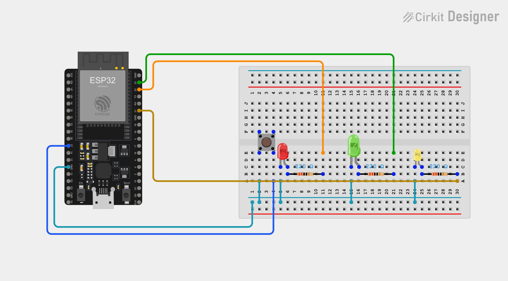

# Circuito da Bancada para o Desafio: ESP32 + Botão + 3 LEDs

**SENAI Alagoinhas · Sistemas Eletrônicos e Microcontrolados**

Este é o circuito que **cada grupo monta na sua bancada** para o desafio. O **botão** faz o papel do **sensor**, e os três LEDs mostram o que a esteira está fazendo. Depois, o mesmo código roda na **planta real**, sem mudança.



*(Esquema feito no Cirkit Designer. Arquivo da imagem: `circuito_bancada_desafio.png`.)*

> ⚠️ **Atenção:** este circuito é **diferente do da Aula 0**. O LED amarelo agora fica no **GPIO 21** (na Aula 0 estava no GPIO 26). **Mova o fio amarelo** do GPIO 26 para o GPIO 21 antes de começar.

---

## 1. O que cada componente representa

| Componente na bancada | Pino | O que mostra | Na planta real vira... |
|---|---|---|---|
| **Botão** ("sensor") | GPIO **27** | Uma peça passando | Sensor infravermelho **E18-D80NK** (saída NPN) |
| **LED verde** | GPIO **23** | **Esteira ligada** | O mesmo LED |
| **LED vermelho** | GPIO **22** | **Lote completo** | O mesmo LED |
| **LED amarelo** | GPIO **21** | **Uma peça sendo contada**: acende com a esteira ligada e o botão apertado | O mesmo LED |

O botão e o sensor NPN se comportam **do mesmo jeito**: quando acionados, o pino vai para **GND** (leitura `LOW`).

> Na bancada **não há LED para o motor**: quem mostra que a esteira está ligada é o **LED verde**. Os pinos **GPIO 26** (IN3) e **GPIO 25** (IN4) só são usados na **planta real**, na ponte H.

---

## 2. Ligações do ESP32

| Pino do ESP32 | Fio no esquema | Vai para |
|---|---|---|
| **GPIO 27** | azul | Protoboard, **coluna 4** (linha A) → botão |
| **GPIO 22** | laranja | Protoboard, **coluna 11** (linha E) → resistor → LED vermelho |
| **GPIO 23** | verde | Protoboard, **coluna 21** (linha E) → resistor → LED verde |
| **GPIO 21** | dourado | Protoboard, **coluna 30** (linha A) → resistor → LED amarelo |
| **GND** (lado esquerdo da placa) | azul-petróleo | **Trilho de GND** da protoboard (coluna 1) |

---

## 3. Mapa da protoboard (por coluna)

As colunas são numeradas de 1 a 30. Cada grupo de cinco furos de uma coluna (**A–E** embaixo, **F–J** em cima) é ligado entre si; o vão do meio separa os dois lados.

| Componente | Colunas | Como fica |
|---|---|---|
| **Botão** | 2 e 4 | Atravessa o vão central (linhas **E** e **F**). **Coluna 2** → jumper (linha A) para o trilho de GND. **Coluna 4** ← fio azul do GPIO 27 |
| **LED vermelho** | 5 e 6 | Pernas na linha **C**. **Coluna 5** → jumper (linha A) para o trilho de GND. **Coluna 6** → resistor 220 Ω (linha B, da coluna 6 à coluna 11) |
| **LED verde** | 15 e 16 | Pernas na linha **C**. **Coluna 15** → jumper (linha A) para o trilho de GND. **Coluna 16** → resistor 220 Ω (linha B, da coluna 16 à coluna 21) |
| **LED amarelo** | 24 e 25 | Pernas na linha **C**. **Coluna 24** → jumper (linha A) para o trilho de GND. **Coluna 25** → resistor 220 Ω (linha B, da coluna 25 à coluna 30) |

### Caminho elétrico

```
GPIO 22 ──fio──► [coluna 11] ──[220 Ω]──► [coluna 6]  ──► LED vermelho ──► [coluna 5]  ──► GND
GPIO 23 ──fio──► [coluna 21] ──[220 Ω]──► [coluna 16] ──► LED verde    ──► [coluna 15] ──► GND
GPIO 21 ──fio──► [coluna 30] ──[220 Ω]──► [coluna 25] ──► LED amarelo  ──► [coluna 24] ──► GND
GPIO 27 ──fio──► [coluna 4]  ──► botão ──► [coluna 2] ──► GND
```

---

## 4. Checklist antes de ligar

- [ ] **GPIO 27** no botão e o outro lado do botão no **GND**, sem resistor externo
- [ ] **Resistor de 220 Ω** em série com cada LED
- [ ] **Polaridade dos LEDs:** perna longa (ânodo, +) do lado do resistor
- [ ] LED verde no **GPIO 23**, vermelho no **GPIO 22** e amarelo no **GPIO 21**
- [ ] **GND** do ESP32 no trilho de GND da protoboard
- [ ] Fio do **GPIO 26** solto (não é usado na bancada)

## 5. Problemas comuns

| Sintoma | Causa provável | Solução |
|---|---|---|
| Nenhum LED acende | GND do ESP32 não está no trilho | Ligue o GND do ESP32 ao trilho de GND |
| Um LED não acende | LED invertido ou resistor solto | Inverta o LED e confira o resistor |
| LED verde e vermelho trocados | Fios do GPIO 22 e 23 invertidos | Confira 23 (verde) e 22 (vermelho) |
| LED amarelo nunca acende | Fio ainda no GPIO 26 (da Aula 0) | Mova o fio para o GPIO 21 |
| O Serial mostra **sempre** `DETECTANDO` | Botão girado 90° na protoboard | Gire o botão |
