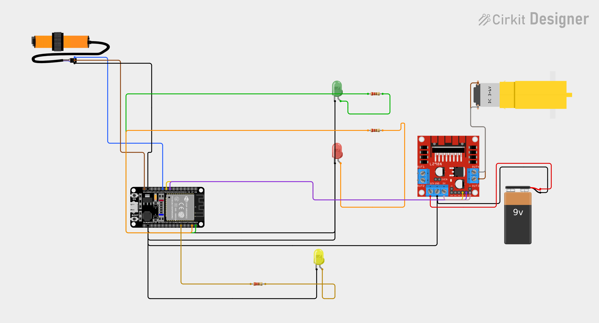
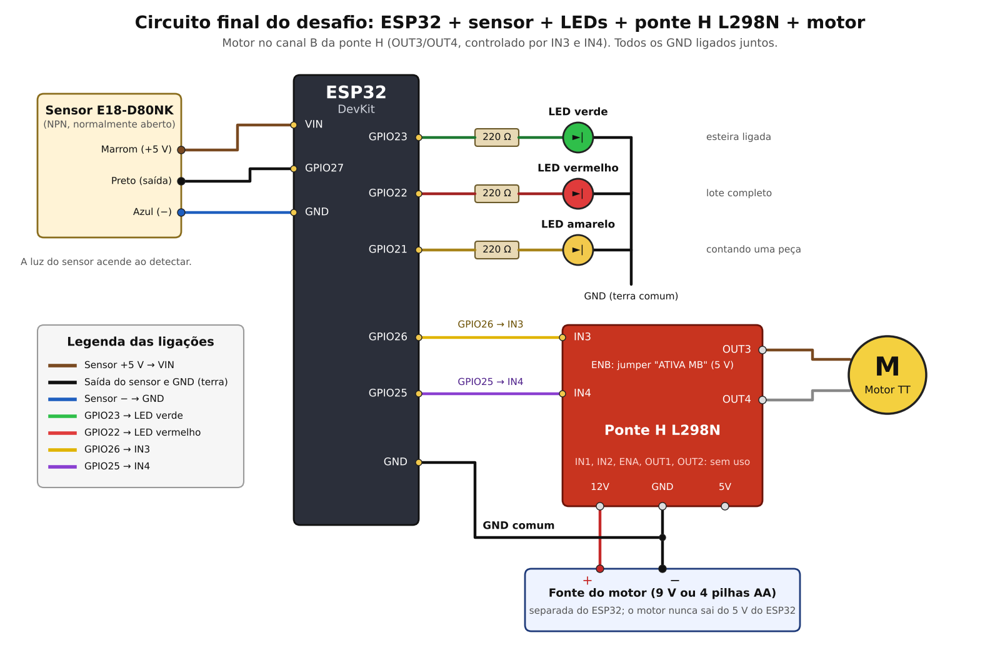

# Circuito Final — Esteira com ESP32, Ponte H e Motor

**SENAI Alagoinhas · Sistemas Eletrônicos e Microcontrolados · Desafio da Contadora de Peças**

Este é o circuito **completo e montado** que o grupo programa no desafio: o ESP32 lê o **sensor**, comanda o **motor da esteira** pela **ponte H L298N** e sinaliza o estado com **três LEDs**.



> O motor usa o **canal B** da ponte H (**OUT3/OUT4**, com **IN3, IN4 e ENB**).

*(Esquema feito no Cirkit Designer. Arquivo da imagem: `circuito_final_desafio.png`.)*

O mesmo circuito em diagrama de blocos, para conferir cada ligação:



*(Arquivo da imagem: `diagrama_ligacoes_desafio.png`.)*

> Na **bancada**, o **botão** representa o sensor infravermelho E18-D80NK (veja `circuito_bancada_desafio.md`). Os dois se comportam do mesmo jeito: quando acionados, o pino vai para **GND** (leitura `LOW`).

---

## 1. Componentes

| Componente | Função |
|---|---|
| **ESP32 DevKit** | Lê o sensor, comanda a esteira e os LEDs, e conversa por MQTT |
| **Botão** (ou sensor **E18-D80NK**) | Detecta a peça |
| **LED verde** + resistor 220 Ω | Esteira em funcionamento |
| **LED vermelho** + resistor 220 Ω | Sinalização de lote completo |
| **LED amarelo** + resistor 220 Ω | Acende enquanto uma peça está sendo contada |
| **Ponte H L298N** | Aciona o motor com a corrente que o ESP32 não consegue fornecer |
| **Motor DC (TT, amarelo)** | Move a esteira |
| **Fonte do motor** (9 V no esquema) | Alimenta o motor, separada do ESP32 |

---

## 2. Ligações do ESP32

| Pino do ESP32 | Fio no esquema | Vai para |
|---|---|---|
| **GPIO 27** | azul | **Botão / sensor** (o outro terminal vai ao GND) |
| **GPIO 23** | verde | Resistor 220 Ω → **LED verde** (ânodo) |
| **GPIO 22** | laranja | Resistor 220 Ω → **LED vermelho** (ânodo) |
| **GPIO 21** | — | Resistor 220 Ω → **LED amarelo** (ânodo) |
| **GPIO 26** | amarelo | **IN3** do L298N |
| **GPIO 25** | roxo | **IN4** do L298N |
| **GND** | preto | **GND comum**: botão, cátodo dos LEDs e GND do L298N |

---

## 3. Ligações do L298N

| Terminal do L298N | Liga em |
|---|---|
| **OUT3** | Terminal do motor |
| **OUT4** | Terminal do motor |
| **12V** (entrada da fonte) | **+** da fonte do motor (fio vermelho) |
| **GND** | **−** da fonte do motor **e** GND do ESP32 (fio preto) |
| **IN3** | GPIO **26** |
| **IN4** | GPIO **25** |
| **ENB** | **5 V** do módulo, mantendo o motor sempre habilitado |
| **IN1, IN2, ENA, OUT1, OUT2** | Sem uso (canal A) |
| Jumper **5VEN** | Colocado (válido para fontes até 12 V) |

> 🔧 **No módulo físico**, o **ENB** já vem com um **jumper "ATIVA MB"**, que faz o papel de ligar o ENB ao 5 V. **Mantenha o jumper** e **não** ligue fio extra do borne 5V ao ENB.

### Como o motor é acionado

| Esteira | IN3 (GPIO 26) | IN4 (GPIO 25) |
|---|---|---|
| **Ligada** | `HIGH` | `LOW` |
| **Parada** | `LOW` | `LOW` |
| Sentido contrário (opcional) | `LOW` | `HIGH` |

Para os alunos, ligar ou desligar a esteira é só um `digitalWrite`: o **GPIO 25 (IN4) fica sempre em `LOW`**.

---

## 4. Alimentação — atenção

```
  USB ───► ESP32 (lógica e Wi-Fi)

  Fonte do motor (+) ───► L298N (12V) ───► motor
  Fonte do motor (−) ───► L298N (GND) ───┬──► GND do ESP32   ← GND COMUM
```

- **Os GNDs precisam estar juntos** (ESP32, L298N e fonte). Sem isso, os sinais de IN3 e IN4 não funcionam direito.
- **Nunca** alimente o motor pelo 5 V ou pelo VIN do ESP32: o pico de corrente reinicia a placa e derruba o Wi-Fi.
- **Tensão do motor:** o L298N "perde" cerca de **2 V**. Com a **bateria de 9 V** do esquema, o motor recebe uns **7 V**, acima dos 6 V nominais do motor TT. Serve para **demonstrações curtas**; para uso contínuo prefira uma entrada de **6 a 7,5 V** (por exemplo, **4 pilhas AA**, que dão 6 V) ou uma fonte regulada.
- A **bateria de 9 V** (tipo bloco) tem pouca capacidade e cai rápido com o motor puxando corrente. Se a esteira ficar fraca ou o motor "engasgar", troque a fonte antes de procurar erro no código.
- O jumper **5VEN** só fica colocado com fonte **de até 12 V**.

---

## 5. Sensor real: E18-D80NK

Na esteira real, o sensor **substitui o botão**, ligado no mesmo pino:

| Fio do sensor | Liga em |
|---|---|
| **Preto** (saída NPN) | **GPIO 27** |
| **Marrom** (+) | **VIN** do ESP32 (5 V do USB) |
| **Azul** (−) | **GND** |

- A saída NPN só **puxa para o GND** ao detectar, e o ESP32 já usa `INPUT_PULLUP`. Por isso o código **não muda**.
- **Aponte o sensor de lado, atravessando a esteira.** A esteira é clara e reflete bem o infravermelho: se ele apontar para baixo, vê a própria esteira como objeto.
- Ajuste o parafuso de trás para um alcance **curto** (uns 5 a 15 cm), para não captar a parede ou quem passa por perto.

---

## 6. Checklist antes de ligar

- [ ] **GND comum** entre ESP32, L298N e fonte do motor
- [ ] Fonte do motor ligada no borne **12V** do L298N, **+** e **−** corretos
- [ ] Motor nos bornes **OUT3** e **OUT4**
- [ ] **IN3** no GPIO **26** e **IN4** no GPIO **25**
- [ ] **ENB** habilitado (jumper "ATIVA MB" colocado)
- [ ] **Polaridade dos LEDs:** perna longa (ânodo +) do lado do resistor
- [ ] **Resistor de 220 Ω** em série com cada LED (verde, vermelho e amarelo)
- [ ] Botão (ou sensor) entre o **GPIO 27** e o **GND**, sem resistor externo
- [ ] O motor **não** está ligado ao 5 V/VIN do ESP32

---

## 7. Teste da esteira

Grave este sketch **antes** de qualquer outro. A esteira liga por 2 s com o LED verde aceso e para por 2 s com o LED vermelho aceso, repetindo. O Serial mostra o estado do botão (ou do sensor).

```cpp
// =====================================================
//  Teste da esteira: motor + LEDs + botao/sensor
// =====================================================
#define SENSOR       27   // botao ou sensor E18-D80NK
#define LED_VERDE    23
#define LED_VERMELHO 22
#define LED_AMARELO  21
#define MOTOR_IN1    26   // ponte H IN3 (motor em OUT3/OUT4)
#define MOTOR_IN2    25   // ponte H IN4 (sempre LOW)

void esteira(bool ligar) {
  digitalWrite(MOTOR_IN1, ligar ? HIGH : LOW);
  digitalWrite(MOTOR_IN2, LOW);
  digitalWrite(LED_VERDE, ligar ? HIGH : LOW);
  digitalWrite(LED_VERMELHO, ligar ? LOW : HIGH);
}

void setup() {
  Serial.begin(115200);
  pinMode(SENSOR, INPUT_PULLUP);
  pinMode(LED_VERDE, OUTPUT);
  pinMode(LED_VERMELHO, OUTPUT);
  pinMode(MOTOR_IN1, OUTPUT);
  pinMode(MOTOR_IN2, OUTPUT);
  esteira(false);
}

void loop() {
  Serial.println("Esteira LIGADA");
  esteira(true);
  delay(2000);
  Serial.println(digitalRead(SENSOR) == LOW ? "sensor: DETECTANDO" : "sensor: livre");

  Serial.println("Esteira PARADA");
  esteira(false);
  delay(2000);
  Serial.println(digitalRead(SENSOR) == LOW ? "sensor: DETECTANDO" : "sensor: livre");
}
```

| Teste | Esperado |
|---|---|
| Gravar e observar | Esteira gira 2 s com o **LED verde**, depois para 2 s com o **LED vermelho** |
| Sensor livre (ou botão solto) | Serial mostra `sensor: livre` |
| Botão apertado (ou objeto na frente do sensor) | Serial mostra `sensor: DETECTANDO` |

---

## 8. Problemas comuns

| Sintoma | Causa provável | Solução |
|---|---|---|
| Motor não gira | Fonte desligada, GND não comum ou ENB sem jumper | Conferir o checklist |
| Motor gira ao contrário | OUT3 e OUT4 invertidos no motor | Inverter os dois fios do motor |
| Motor fraco ou "engasgando" | Bateria fraca ou perda de ~2 V no L298N | Trocar a fonte (6 a 7,5 V) |
| ESP32 reinicia quando o motor liga | Motor alimentado pelo ESP32, ou fonte sem corrente | Alimentar o motor só pela fonte externa |
| LED verde e vermelho trocados | Fios do GPIO 22 e 23 invertidos | Conferir 23 (verde) e 22 (vermelho) |
| Serial mostra **sempre** `DETECTANDO` | Sensor enxergando a própria esteira, ou botão girado 90° | Reapontar o sensor; girar o botão |
| Serial mostra **sempre** `livre` | Fio do GPIO 27 solto, ou sensor sem alimentação | Conferir o GPIO 27 e o marrom/azul do sensor |

---

## 9. Do esquema para o código

Os pinos deste circuito são **os mesmos** usados nos códigos do desafio:

| Constante no código | Pino | Função |
|---|---|---|
| `SENSOR` | GPIO **27** | Botão ou sensor E18-D80NK |
| `LED_VERDE` | GPIO **23** | Esteira em funcionamento |
| `LED_VERMELHO` | GPIO **22** | Lote completo |
| `LED_AMARELO` | GPIO **21** | Peça sendo contada (esteira ligada e sensor detectando) |
| `MOTOR_IN1` | GPIO **26** | Ponte H IN3 |
| `MOTOR_IN2` | GPIO **25** | Ponte H IN4 (sempre `LOW`) |

> ⚠️ **Ninguém mexe na fiação do L298N, da fonte ou do sensor.** Se algo parecer errado, chame o professor.
