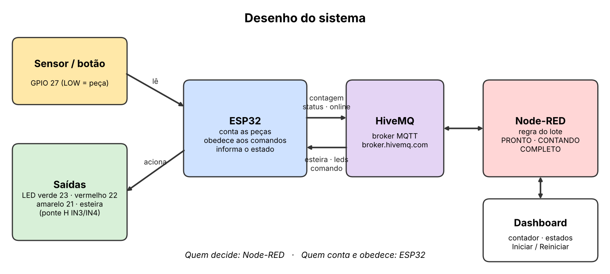

# Desafio: Contadora de Peças

**SENAI Alagoinhas · Sistemas Eletrônicos e Microcontrolados · 3 etapas de 2h30 · Grupos de 4**

Uma esteira leva peças até um sensor. O sistema deve **contar 5 peças e parar sozinho**, mostrando tudo em um **dashboard**. Vocês recebem parte do código do ESP32 e um guia para montar o dashboard. **O que falta é de vocês.**

> Comece por aqui. Este documento diz **o que o sistema deve fazer**, **como o trabalho se divide** e **o que entregar**. Os outros arquivos explicam o **como**.

---

## 1. Como o sistema funciona


*Circuito final montado na planta. Detalhes em [circuito_final_desafio.md](circuito_final_desafio.md).*



```
 Sensor/botão ─► ESP32 (conta) ──{"contagem": N}──► HiveMQ ──► Node-RED (regra do lote)
      ▲                                                          │ ├──► Dashboard (contador, estado)
      │                                                          │ └──◄ botões Iniciar / Reiniciar
      └──── esteira · led_verde · led_vermelho · comando ◄───────┘
```

| Quem | Faz o quê |
|---|---|
| **ESP32** | Lê o sensor, **conta** as peças, liga/desliga esteira e LEDs, **obedece** aos comandos e informa seu estado |
| **Node-RED** | Guarda a **regra do lote** (PRONTO, CONTANDO, COMPLETO), decide quando parar e mostra o dashboard |
| **HiveMQ** | Broker MQTT público que liga os dois |

Quem **decide** é o Node-RED. Quem **conta e obedece** é o ESP32.

---

## 2. Comportamento esperado

### 2.1 Os três estados do lote

| Estado | Esteira | LED verde | LED vermelho | Texto no dashboard |
|---|---|---|---|---|
| **PRONTO** (início) | parada | apagado | apagado | `Pronto` |
| **CONTANDO** (após **Iniciar**) | **ligada** | **aceso** | apagado | `Contando: X de 5` |
| **COMPLETO** (chegou a 5) | **parada** | apagado | **aceso** | `Lote completo` |
| **Reiniciar** | volta a zero | apagado | apagado | `Pronto` |

### 2.2 Regras da contagem

- Só conta peça enquanto a esteira está **ligada**.
- **Cada peça conta uma vez só**, não importa quanto tempo fique na frente do sensor.
- O ESP32 ignora o tremor do botão (*debounce* de 50 ms).
- Ao receber `RESET`, o ESP32 zera a contagem e **avisa** o Node-RED.
- Ao chegar a **5 peças**, o Node-RED manda parar a esteira e acender o LED vermelho.

### 2.3 LED amarelo: peça sendo contada

O **LED amarelo (GPIO 21)** acende **enquanto uma peça está sendo contada**: a esteira está ligada **e** o sensor está detectando. Apaga quando a peça sai ou a esteira para.

### 2.4 Monitoramento dos estados

O sistema mostra o que cada parte está fazendo, no **ESP32** (Serial Monitor) e no **dashboard**:

| Informação | No Serial Monitor | No dashboard |
|---|---|---|
| Esteira | `Esteira: LIGADA / PARADA` | 🟢 ligada · ⚫ parada |
| LED verde / vermelho / amarelo | linha `[STATUS]` | 🟢 🔴 🟡 aceso · ⚫ apagado |
| Sensor | linha `[STATUS]` | 🟠 detectando · ⚪ livre |
| Wi-Fi (sinal) | linha `[STATUS]` | sinal em dBm |
| ESP32 online | conexão com o broker | 🟢 online · 🔴 offline |
| Contagem | `Contagem: N` | contador e medidor |

Se o ESP32 for desligado, o dashboard deve mostrar **offline** em poucos segundos.

---

## 3. Bancada × Planta

| | **Bancada (etapas 1 e 2)** | **Planta real (etapa 3)** |
|---|---|---|
| Sensor | **Botão** (GPIO 27 → GND) | Sensor **E18-D80NK** (saída NPN) |
| Esteira | LED verde mostra "esteira ligada" | Ponte H L298N + motor (IN3 = GPIO 26, IN4 = GPIO 25) |
| LED verde / vermelho / amarelo | GPIO 23 / 22 / 21 | GPIO 23 / 22 / 21 |

O botão e o sensor NPN se comportam **do mesmo jeito** (detectou = `LOW`). Por isso o código da bancada funciona na planta **sem mudar nada**.

⚠️ **Na planta, ninguém mexe na fiação do L298N, da fonte ou do sensor.** Só o professor encaixa o ESP32 do grupo.

Esquemas: [`circuito_bancada_desafio.md`](circuito_bancada_desafio.md) e [`circuito_final_desafio.md`](circuito_final_desafio.md).

---

## 4. O que vocês recebem e o que falta fazer

| Parte | Já vem pronto | Vocês fazem |
|---|---|---|
| **Código do ESP32** ([`codigos/desafio_base_esp32/`](codigos/desafio_base_esp32/desafio_base_esp32.ino)) | Wi-Fi, MQTT, reconexão, LEDs, esteira, monitoramento | **4 TODOs** de lógica ([`desafio_todos_esp32.md`](desafio_todos_esp32.md)) |
| **Dashboard** ([`guia_dashboard_node_red_desafio.md`](guia_dashboard_node_red_desafio.md)) | As 3 funções para colar, o passo a passo e o fluxo de referência | **Montar o fluxo** e os widgets no Node-RED |
| **Circuitos** | Esquemas e checklists | **Montar** a bancada |

Você **não escreve JavaScript**: as funções do Node-RED estão prontas no guia. Consultem os códigos da **Aula 0** ([`codigos/aula0/`](codigos/aula0/)) à vontade.

### Tópicos MQTT

Prefixo: `senai_alagoinhas_2026/desafio/grupoXX/` (troque `XX` pelo **seu** grupo).

| Tópico | Direção | Conteúdo |
|---|---|---|
| `contagem` | ESP32 → Node-RED | `{"contagem": 3}` |
| `esteira` | Node-RED → ESP32 | `ON` / `OFF` |
| `led_verde` | Node-RED → ESP32 | `ON` / `OFF` |
| `led_vermelho` | Node-RED → ESP32 | `ON` / `OFF` |
| `comando` | Node-RED → ESP32 | `RESET` |
| `status` | ESP32 → Node-RED | JSON com os estados |
| `online` | ESP32 → Node-RED | `online` / `offline` |

O broker é público: **cada grupo usa só o seu número**, mesmo testando em casa.

---

## 5. Como o trabalho se divide

| Etapa | Onde | Meta |
|---|---|---|
| **1** | Bancada | Montar o circuito, passar nos testes e **completar os 4 TODOs**. Ao final, o Serial conta de 1 a 5 |
| **2** | Bancada | **Montar o dashboard** no Node-RED e fechar o ciclo completo com o ESP32 |
| **3** | Bancada e **planta** | Revisar, escolher **bônus** e **validar na planta**, com os grupos se revezando (cerca de 35 min cada) |

Quatro papéis, que **giram a cada etapa**:

| Papel | Cuida de |
|---|---|
| **ESP32: sensor** | `INPUT_PULLUP`, borda, debounce, contagem |
| **ESP32: atuadores** | `callback`, esteira, LEDs, publicação |
| **Node-RED** | fluxo MQTT, funções, botões |
| **Dashboard e testes** | widgets, testes de aceite, prints e vídeo |

- **Um teclado por vez** (piloto), com troca a cada 30 minutos.
- Todo mundo precisa **entender e explicar qualquer trecho**. Na avaliação, o professor sorteia quem explica.

---

## 6. Testes de aceite

O grupo só considera pronto quando **todos** passam na bancada:

| # | Teste | Resultado esperado |
|---|---|---|
| 1 | Ligar tudo | Dashboard `Pronto`, ESP32 **online**, LEDs apagados |
| 2 | Apertar o botão com a esteira parada | **Não conta** |
| 3 | Clicar **Iniciar** | `Contando: 0 de 5`, LED verde aceso |
| 4 | Segurar o botão por 3 s | Conta **só 1**; LED amarelo aceso enquanto segura |
| 5 | Apertar o botão 4 vezes rápido | Contagem 1, 2, 3, 4, sem pular nem repetir |
| 6 | Chegar à 5ª peça | `Lote completo`, esteira parada, LED vermelho aceso |
| 7 | Apertar o botão com o lote completo | **Não conta** |
| 8 | Clicar **Reiniciar** | Contagem 0, `Pronto`, LEDs apagados |
| 9 | Desligar o ESP32 | Dashboard mostra **offline** |

---

## 7. Na planta

1. O professor encaixa o **ESP32 do grupo** na planta.
2. **Confiram o sensor sem a esteira:** passem a mão/peça na frente dele e vejam o Serial contar.
3. Executem o ciclo completo com **5 peças reais**: Iniciar → contar 5 → parar → Reiniciar.
4. Observem: **a esteira para exatamente na 5ª peça ou anda um pouco mais?** Por quê?
5. Gravem o **vídeo** da demonstração.

### Bônus (escolham pelo menos 2)

| # | Bônus | Dica |
|---|---|---|
| ⭐ A | **Lote ajustável** por slider no dashboard (1 a 10 peças) | `ui_slider` + `flow.set` |
| ⭐ B | **Parada local:** o ESP32 também confere o lote e para a esteira **na hora** | O ESP32 precisa conhecer o lote. Compare o tempo de parada com e sem ela |
| ⭐ C | **Alarme "esteira sem peças":** esteira ligada há mais de X segundos sem contar | `millis()` guardando a última peça |
| ⭐ D | **Peças por minuto** no dashboard | Intervalo entre peças no Node-RED |
| ⭐ E | **Histórico** das contagens com a tag `grupo` | InfluxDB, como na aula 10 |

---

## 8. O que entregar

| # | Entrega | Detalhe |
|---|---|---|
| 1 | **Código do ESP32** (`.ino`) | Completo, comentado, com o **número do grupo** |
| 2 | **Fluxo do Node-RED** | Menu ☰ → Exportar (sem tokens ou senhas) |
| 3 | **Prints do dashboard** | Nos três estados: `Pronto`, `Contando` e `Lote completo` |
| 4 | **Vídeo curto** da planta | O ciclo completo com 5 peças |
| 5 | **Respostas às 3 perguntas** | Abaixo |

**Perguntas finais:**

1. Por que a contagem é feita **na mudança do sinal** (borda) e não enquanto o sensor está em `LOW`?
2. Por que a regra do lote fica no **Node-RED**? O que acontece com a esteira se o Node-RED parar?
3. Por que a esteira pode andar um pouco além da 5ª peça? Como evitar isso?

### Como será avaliado

| Critério | Peso |
|---|---|
| Funciona na bancada (testes de aceite) | 30 % |
| Funciona na planta | 20 % |
| Bônus (qualidade e funcionamento) | 15 % |
| Código organizado, comentado e com nomes claros | 10 % |
| **Explicação individual** (o professor sorteia quem explica qual trecho) | 25 % |

---

## 9. Mapa dos arquivos

| Preciso de... | Abra |
|---|---|
| Montar a bancada | [`circuito_bancada_desafio.md`](circuito_bancada_desafio.md) |
| Ver a planta real | [`circuito_final_desafio.md`](circuito_final_desafio.md) |
| Completar o código | [`desafio_todos_esp32.md`](desafio_todos_esp32.md) e [`codigos/desafio_base_esp32/`](codigos/desafio_base_esp32/desafio_base_esp32.ino) |
| Montar o dashboard | [`guia_dashboard_node_red_desafio.md`](guia_dashboard_node_red_desafio.md) |
| Testar botão, LEDs e motor | [`codigos/testes/`](codigos/testes/) |
| Rever a Aula 0 | [`aula0/`](aula0/aula0_guia_do_aluno.md) e [`codigos/aula0/`](codigos/aula0/) |

## 10. Cola rápida

| Item | Valor |
|---|---|
| Broker | `broker.hivemq.com` : `1883` |
| Sensor / botão | GPIO **27** (`INPUT_PULLUP`, detectou = `LOW`) |
| LED verde / vermelho / amarelo | GPIO **23** / **22** / **21** |
| Motor (ponte H, só na planta) | IN3 = GPIO **26** · IN4 = GPIO **25** (sempre `LOW`) |
| Lote | 5 peças |
| Node-RED | http://localhost:1880 · dashboard em `/ui` |
