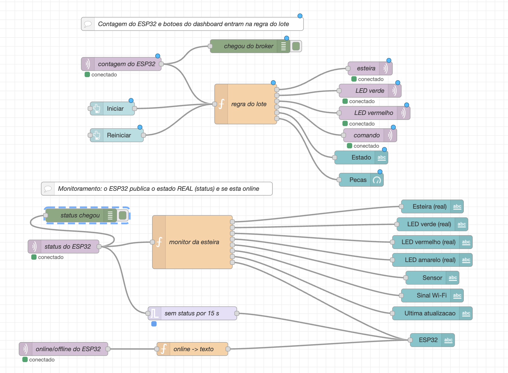
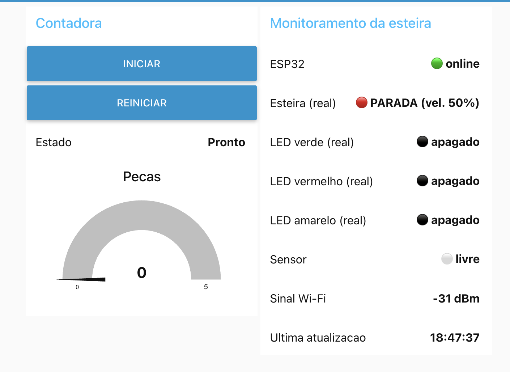
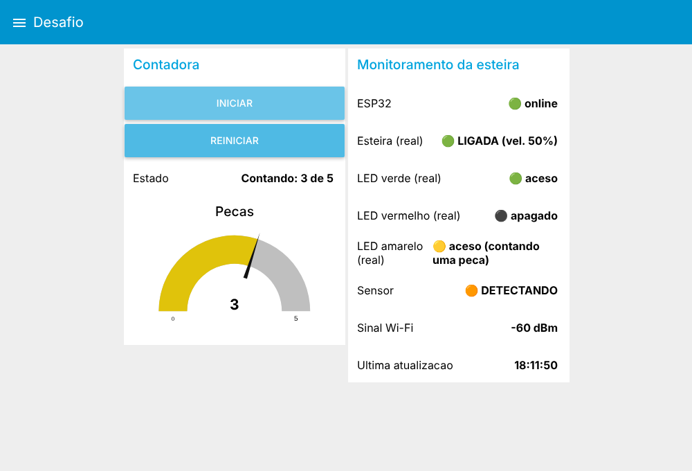

# Guia do Dashboard: montando o painel do desafio no Node-RED

**SENAI Alagoinhas · Sistemas Eletrônicos e Microcontrolados**

Neste guia vocês **montam o painel** que conversa com o ESP32. Não é preciso programar nada no Node-RED: as **três funções** estão prontas, e vocês só colam o código, configuram os nós e fazem as ligações. A parte de programação do desafio está no **código do ESP32**.



*Fluxo completo. Em cima, o ciclo do lote. Embaixo, o monitoramento da esteira.*



*Dashboard pronto, no estado **Pronto**, com o ESP32 online.*

> **Antes de começar:** troque **`grupoXX`** pelo número do **seu** grupo (por exemplo `grupo03`) em **todos** os tópicos. O broker é público: se dois grupos usarem o mesmo número, um atrapalha o outro.
>
> Para lembrar como configurar cada tipo de nó, consulte as **receitas do Node-RED** no guia da Aula 0 (`aula0_guia_do_aluno.md`):
>
> | Nó | Receita da Aula 0 |
> |---|---|
> | Criar o fluxo | **R1** |
> | Colocar e ligar nós | **R2** |
> | `mqtt in` | **R3** |
> | `mqtt out` | **R4** |
> | `button` | **R5** |
> | `text` | **R6** |
> | `function` | **R7** |
> | `debug` | **R8** |
> | `gauge` | **R9** |
> | Implementar e abrir o dashboard | **R10** |
> | Trocar `grupo01` pelo número do grupo | **R11** |
>
> O nó **`inject`** e o nó **`trigger`** são novos: ficam explicados aqui mesmo, nas seções 2.5 e 3.1.

---

## 1. Preparação

1. Abra o Node-RED (`http://localhost:1880`) e crie um **novo fluxo** (botão **+** nas abas). Dê o nome **Desafio**.
2. Confirme que a paleta **`node-red-dashboard`** está instalada (vocês já usaram na Aula 0).
3. **Broker:** ao configurar o primeiro nó mqtt, crie o servidor:

| Campo | Valor |
|---|---|
| Servidor | `broker.hivemq.com` |
| Porta | `1883` |

   Os demais nós mqtt reaproveitam esse mesmo servidor.

4. **Dashboard:** crie uma **aba** chamada **Desafio** e dois **grupos** nela:

| Grupo | Para quê |
|---|---|
| **Contadora** | botões, estado e contador de peças |
| **Monitoramento da esteira** | o que o ESP32 está fazendo de verdade |

---

## 2. Parte 1: o ciclo do lote

### 2.1. Nós de entrada

*Referências da Aula 0: R3 (mqtt in), R5 (button), R8 (debug).*

| Nó | Nome | Configuração |
|---|---|---|
| **mqtt in** | `contagem do ESP32` | Tópico `senai_alagoinhas_2026/desafio/grupoXX/contagem` · QoS 0 · Saída: **objeto JSON analisado** |
| **button** | `Iniciar` | Grupo **Contadora** · Rótulo `Iniciar` · Payload (**texto**) `INICIAR` · **Tópico (texto) `botao`** |
| **button** | `Reiniciar` | Grupo **Contadora** · Rótulo `Reiniciar` · Payload (**texto**) `REINICIAR` · **Tópico (texto) `botao`** |
| **debug** | `chegou do broker` | Mostra `msg.payload` (ajuda a ver se o ESP32 está publicando) |

> O **tópico `botao`** é obrigatório nos dois botões. É por ele que a função sabe que a mensagem veio de um botão, e não do ESP32.

### 2.2. A função `regra do lote`

*Referência da Aula 0: R7 (function). O Alarme e a Sala usam o mesmo padrão de estado.*

Arraste um nó **function**, dê o nome **`regra do lote`**, abra a aba **Setup** (Configuração) e mude **Saídas** para **6**. Na aba **Mensagem** (Corpo da função), **cole** o código abaixo:

```js
// ===== REGRA DO LOTE =====
var LOTE = 5;   // pecas por lote

// O que a regra lembra entre uma mensagem e outra
var estado   = context.get("estado")   || "PRONTO";   // PRONTO, CONTANDO ou COMPLETO
var contagem = context.get("contagem") || 0;

var comandoReset = null;   // so vira mensagem quando o operador reinicia

// --- 1) O que chegou? ---
if (msg.topic === "botao") {
    // veio de um botao do dashboard
    if (msg.payload === "INICIAR" && estado === "PRONTO") {
        estado = "CONTANDO";
    } else if (msg.payload === "REINICIAR") {
        estado = "PRONTO";
        contagem = 0;
        comandoReset = { payload: "RESET" };
    }
} else {
    // veio o JSON do ESP32: {"contagem": 3}
    if (msg.payload && typeof msg.payload.contagem === "number") {
        contagem = msg.payload.contagem;
        if (estado === "CONTANDO" && contagem >= LOTE) {
            estado = "COMPLETO";
        }
    }
}

context.set("estado", estado);
context.set("contagem", contagem);

// --- 2) Monta as mensagens de saida de acordo com o ESTADO ---
var esteira  = { payload: estado === "CONTANDO" ? "ON" : "OFF" };
var verde    = { payload: estado === "CONTANDO" ? "ON" : "OFF" };
var vermelho = { payload: estado === "COMPLETO" ? "ON" : "OFF" };
var texto    = { payload: estado === "PRONTO"   ? "Pronto"
                        : estado === "CONTANDO" ? "Contando: " + contagem + " de " + LOTE
                        : "Lote completo" };
var numero   = { payload: contagem };

return [esteira, verde, vermelho, comandoReset, texto, numero];
```

**O que ela faz, sem precisar mexer:**

| Estado | Quando entra | Esteira | LED verde | LED vermelho |
|---|---|---|---|---|
| **PRONTO** | ao abrir ou ao clicar em Reiniciar | parada | apagado | apagado |
| **CONTANDO** | ao clicar em Iniciar | **ligada** | **aceso** | apagado |
| **COMPLETO** | quando a contagem chega a 5 | parada | apagado | **aceso** |

### 2.3. Nós de saída

*Referências da Aula 0: R4 (mqtt out), R6 (text), R9 (gauge).*

| Nó | Nome | Configuração |
|---|---|---|
| **mqtt out** | `esteira` | Tópico `senai_alagoinhas_2026/desafio/grupoXX/esteira` · QoS 0 · Retain **não** |
| **mqtt out** | `LED verde` | Tópico `senai_alagoinhas_2026/desafio/grupoXX/led_verde` |
| **mqtt out** | `LED vermelho` | Tópico `senai_alagoinhas_2026/desafio/grupoXX/led_vermelho` |
| **mqtt out** | `comando` | Tópico `senai_alagoinhas_2026/desafio/grupoXX/comando` |
| **text** | `Estado` | Grupo **Contadora** · Rótulo `Estado` · Valor `{{msg.payload}}` |
| **gauge** | `Pecas` | Grupo **Contadora** · Título `Peças` · Mín `0` · Máx `5` |

### 2.4. Ligações (fios)

| De | Para |
|---|---|
| `contagem do ESP32` | `chegou do broker` **e** `regra do lote` |
| `Iniciar` | `regra do lote` |
| `Reiniciar` | `regra do lote` |
| `regra do lote` · **saída 1** | `esteira` |
| `regra do lote` · **saída 2** | `LED verde` |
| `regra do lote` · **saída 3** | `LED vermelho` |
| `regra do lote` · **saída 4** | `comando` |
| `regra do lote` · **saída 5** | `Estado` |
| `regra do lote` · **saída 6** | `Pecas` |

Clique em **Implementar** (Deploy) e abra o dashboard em `http://localhost:1880/ui`.

### 2.5. Teste sem o ESP32 (nó temporário)

Para ver a regra funcionando antes de ligar o ESP32:

1. Arraste um nó **inject**, configure o payload como **JSON** `{"contagem":3}` e ligue na entrada de `regra do lote`.
2. Implemente. No dashboard, clique em **Iniciar** e depois no botão do nó inject.

| Passo | Esperado no dashboard |
|---|---|
| Abrir a página | **Pronto**, contador em 0 |
| Clicar em **Iniciar** | **Contando: 0 de 5** |
| Disparar o inject com `{"contagem":3}` | **Contando: 3 de 5**, contador em 3 |
| Disparar com `{"contagem":5}` | **Lote completo**, contador em 5 |
| Clicar em **Reiniciar** | **Pronto**, contador em 0 |

Quando funcionar, **apague o nó inject**.

---

## 3. Parte 2: monitoramento da esteira

O ESP32 publica o **estado real** dele: se a esteira está girando, quais LEDs estão acesos (inclusive o **amarelo**, que acende enquanto uma peça está sendo contada), o que o sensor vê e o sinal de Wi-Fi. Este painel mostra isso e avisa quando o ESP32 some.

### 3.1. Nós

*Referências da Aula 0: R3, R6 e R7. O `trigger` é novo (veja a configuração na tabela).*

| Nó | Nome | Configuração |
|---|---|---|
| **mqtt in** | `status do ESP32` | Tópico `senai_alagoinhas_2026/desafio/grupoXX/status` · Saída: **objeto JSON analisado** |
| **mqtt in** | `online/offline do ESP32` | Tópico `senai_alagoinhas_2026/desafio/grupoXX/online` · Saída: **texto** (string) |
| **function** | `monitor da esteira` | **8 saídas** · código na seção 3.2 |
| **function** | `online -> texto` | 1 saída · código na seção 3.2 |
| **trigger** | `sem status por 15 s` | Enviar: **nada** · Depois: esperar **15 segundos**, então enviar a **string** `🔴 sem sinal (15 s)` · marque **estender o atraso se uma nova mensagem chegar** |
| **text** × 8 | veja a tabela abaixo | Grupo **Monitoramento da esteira** · Valor `{{msg.payload}}` |

Os 8 nós **text** (todos no grupo **Monitoramento da esteira**), na ordem em que aparecem no painel:

| Ordem | Rótulo |
|---|---|
| 1 | `ESP32` |
| 2 | `Esteira (real)` |
| 3 | `LED verde (real)` |
| 4 | `LED vermelho (real)` |
| 5 | `LED amarelo (real)` |
| 6 | `Sensor` |
| 7 | `Sinal Wi-Fi` |
| 8 | `Ultima atualizacao` |

### 3.2. Código das funções

**`monitor da esteira`** (8 saídas):

```js
// ===== MONITOR DA ESTEIRA =====
// msg.payload = JSON publicado pelo ESP32 no topico "status":
// {"esteira":"LIGADA","velocidade":50,"led_verde":"ON","led_vermelho":"OFF",
//  "led_amarelo":"OFF","sensor":"LIVRE","contagem":2,"rssi":-60,"uptime_s":123}
var s = msg.payload;
if (typeof s !== "object" || s === null) return null;

var esteira  = { payload: (s.esteira === "LIGADA" ? "🟢 LIGADA" : "🔴 PARADA") + " (vel. " + s.velocidade + "%)" };
var verde    = { payload: s.led_verde === "ON" ? "🟢 aceso" : "⚫ apagado" };
var vermelho = { payload: s.led_vermelho === "ON" ? "🔴 aceso" : "⚫ apagado" };
var amarelo  = { payload: s.led_amarelo === "ON" ? "🟡 aceso (contando uma peca)" : "⚫ apagado" };
var sensor   = { payload: s.sensor === "DETECTANDO" ? "🟠 DETECTANDO" : "⚪ livre" };
var wifi     = { payload: s.rssi + " dBm" };
var hora     = { payload: new Date().toLocaleTimeString("pt-BR") };
var online   = { payload: "🟢 online" };

return [esteira, verde, vermelho, amarelo, sensor, wifi, hora, online];
```

**`online -> texto`** (1 saída):

```js
// topico "online": o ESP32 publica "online" ao conectar;
// o broker publica "offline" (testamento) se ele cair sem avisar.
var v = String(msg.payload).trim();
return { payload: v === "online" ? "🟢 online" : "🔴 offline" };
```

### 3.3. Ligações (fios)

| De | Para |
|---|---|
| `status do ESP32` | `monitor da esteira` **e** `sem status por 15 s` |
| `monitor da esteira` · **saída 1** | texto `Esteira (real)` |
| `monitor da esteira` · **saída 2** | texto `LED verde (real)` |
| `monitor da esteira` · **saída 3** | texto `LED vermelho (real)` |
| `monitor da esteira` · **saída 4** | texto `LED amarelo (real)` |
| `monitor da esteira` · **saída 5** | texto `Sensor` |
| `monitor da esteira` · **saída 6** | texto `Sinal Wi-Fi` |
| `monitor da esteira` · **saída 7** | texto `Ultima atualizacao` |
| `monitor da esteira` · **saída 8** | texto `ESP32` |
| `sem status por 15 s` | texto `ESP32` |
| `online/offline do ESP32` | `online -> texto` |
| `online -> texto` | texto `ESP32` |

Implemente de novo. O painel completo deve ficar assim:



---

## 4. Teste com o ESP32

Com o código do ESP32 completo, gravado e conectado no Wi-Fi:

| Ação | Esperado |
|---|---|
| Ligar o ESP32 | **ESP32: 🟢 online** e os dados reais aparecem em até 5 s |
| Clicar em **Iniciar** | Esteira (real) **LIGADA**, LED verde **aceso**, Estado **Contando: 0 de 5** |
| Passar a peça no sensor | **Sensor 🟠 DETECTANDO**, **LED amarelo 🟡 aceso** enquanto a peça passa, e depois **livre**; o contador sobe **1** |
| Chegar a 5 peças | Esteira **PARADA**, LED vermelho **aceso**, **Lote completo** |
| Clicar em **Reiniciar** | Tudo volta a **Pronto**, contador em **0** |
| Desligar o ESP32 | **ESP32: 🔴 offline** (ou 🔴 sem sinal após 15 s) |

---

## 5. Problemas comuns

| Sintoma | Causa provável | O que fazer |
|---|---|---|
| Nenhum nó mqtt fica **conectado** | Servidor ou porta errados, ou a rede bloqueia a porta 1883 | Confira `broker.hivemq.com` e `1883` no nó do servidor |
| O dashboard abre mas nada muda | Número do grupo diferente no Node-RED e no ESP32 | Compare os tópicos nos dois lados |
| **Iniciar** não faz nada | Botão sem o tópico `botao`, ou sem ligar na função | Reveja a configuração do botão e os fios |
| Estado muda mas a esteira não liga | Fio da saída 1 não está ligado em `esteira`, ou o `callback` do ESP32 está incompleto | Reveja os fios e o código do ESP32 |
| O contador nunca sobe | O ESP32 não está publicando a contagem | Olhe o debug `chegou do broker` e o Serial do ESP32 |
| Apareceu erro na função | Código colado incompleto ou **saídas** diferentes do indicado | Cole de novo o código inteiro e confira **6 saídas** (lote) e **8** (monitor) |
| O painel de monitoramento fica **sem sinal** | O ESP32 está desconectado ou usa outro grupo | Confira o Serial do ESP32 e os tópicos `status` e `online` |
| Texto sem emoji ou com quadrados | A fonte do navegador não tem emoji | Não afeta o funcionamento |

---

## 6. Referência rápida dos tópicos

| Tópico (`senai_alagoinhas_2026/desafio/grupoXX/…`) | Quem publica | Conteúdo |
|---|---|---|
| `contagem` | ESP32 | `{"contagem":3}` |
| `esteira` | Node-RED | `ON` ou `OFF` |
| `led_verde` | Node-RED | `ON` ou `OFF` |
| `led_vermelho` | Node-RED | `ON` ou `OFF` |
| `comando` | Node-RED | `RESET` |
| `status` | ESP32 | JSON com esteira, LEDs (verde, vermelho, amarelo), sensor, contagem, Wi-Fi |
| `online` | ESP32 | `online` ou `offline` |
